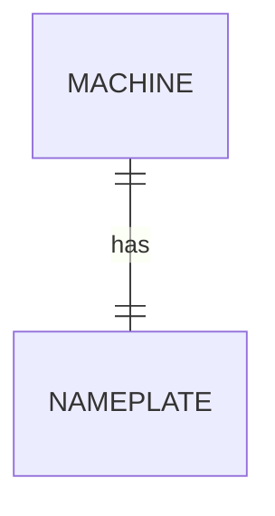

# Module 2 Study Log

**Members:** <Rayan Slassi, Aron Grudaj, Jonathan Behring> | **Date:** <15.10.2026>

---

## Task A: Pod study

### 1. References I used

| <ER model> | <https://en.wikipedia.org/wiki/Entity%E2%80%93relationship_model> | <Learned the basic idea oh how an ER model should look> |
| <EER model> | <https://en.wikipedia.org/wiki/Enhanced_entity%E2%80%93relationship_model> | <Enhanced version of the regular ER Model> |

### 2. Things I googled
- **<term/question>**: <how to do a digramm online> ([source](<URL>))

### 3. Remarkable things
- <surprise / aha / counterexample>

### 4. LLM Q&A
**Prompt:** <exact prompt you used>
**Answer (summary):** <2-3 lines>
**How I verified it:** <what query or source you checked it against>
**Where it was wrong or vague:** <honest note>

### 5. My best ER sketches
**Sketch 1**
- Source: <link or credit>
- Image: 
- What I learned that the others didn't show: <sentence>
---

## Task B: From words to sketch

### 1. 1:1 (machine and nameplate)
- Entities: <...>
- Attributes: <...>
- Relationship and cardinality: <...>
- Where the key goes / entity or attribute?: <answer>



### 2. 1:n (machine and sensors)
(same structure)

### 3. m:n (work orders and parts)
(same structure)

### 4. Entity vs. attribute vs. relationship (job, machine, technician)
(same structure)

### Proof: CREATE TABLE and COUNT
```sql
-- CREATE TABLE for my favourite sketch
-- two INSERT statements
-- the COUNT query that shows the cardinality
```
**Result:** <paste output and one sentence of interpretation>

---

## Task C: Agreed learning (pod discussion)
- **Shared points (3-5):** <...>
- **Learning we jointly stand behind:** <...>
- **Open disagreements:** <...>
- **Image posted in Discord:** <description or file> (why: <one sentence>)

- Aha: Defect 3 — `unit_price < '15'` on TEXT excluded P-1003 (€9.90) because `'9.90' > '15'` as string. The cheapest part vanishes from the report. No error. This is exactly the kind of silent corruption the module warns about.