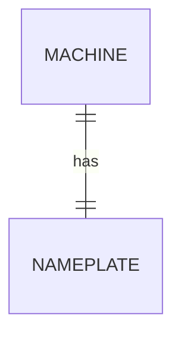
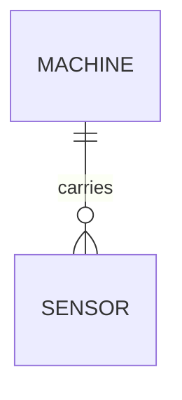
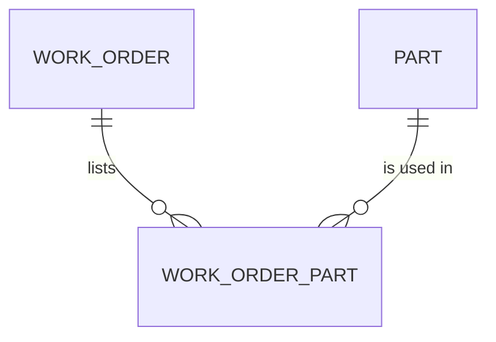
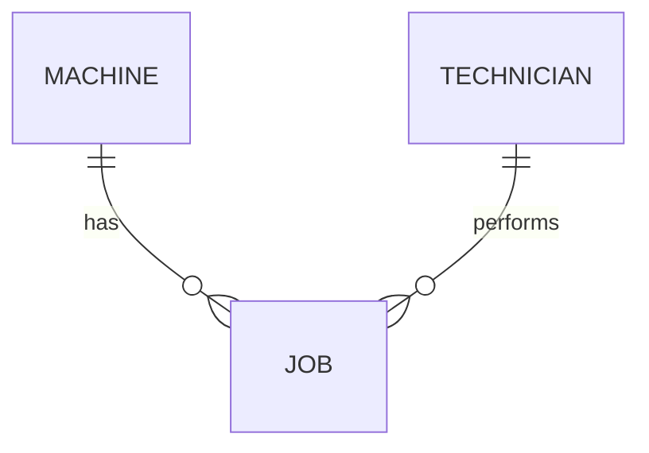

# Module 2 Study Log

[← Module 2 README](README.md)

**Members:** Rayan Slassi, Aron Grudaj, Jonathan Behring | **Date:** 15.10.2026

---

## Task A: Pod study

### 1. References I used

| Topic | Source | What I learned |
|---|---|---|
| ER model | <https://en.wikipedia.org/wiki/Entity%E2%80%93relationship_model> | The basic idea of how an ER model should look: entities, attributes and the relationships between them |
| EER model | <https://en.wikipedia.org/wiki/Enhanced_entity%E2%80%93relationship_model> | The enhanced version of the regular ER model, which adds sub-types and inheritance |

### 2. Things I googled
What is a surrogate key? And what is a natural key?

### 3. Remarkable things
- A natural key without a `UNIQUE` rule is not really a key: in `legacy.db` the part number `P-1003` exists twice, and the database never complained.

### 4. LLM Q&A
**Prompt:** "Explain the difference between a natural key and a surrogate key, and give one real scenario where choosing the wrong one causes a data bug."
**Answer (summary):** A natural key is real-world data (email, serial number). A surrogate key is a synthetic ID. Using a natural key as PK is risky if the value can change (e.g. a person's email address). The wrong choice causes update anomalies when the natural key changes.
**How I verified it:** Ran `SELECT part_no, COUNT(*) FROM part GROUP BY part_no HAVING COUNT(*) > 1;` on `legacy.db`. Confirmed `P-1003` is duplicated because `part_no` has no UNIQUE. This proves the LLM's claim: "without a UNIQUE constraint, a natural key is not actually a key."

### 5. My best ER sketches
**Sketch 1**
- Source: an example ER diagram of a school system that I studied (the image file itself was not uploaded to this repository; my Module 2 screenshot is in the [pictures for Module 2](pictures/README.md)).

**Sketch 2**
- The m:n sketch of work orders and parts in [Task B](#3-mn-work-orders-and-parts) below, because it shows why a junction table is needed.

---

## Task B: From words to sketch

### 1. 1:1 (machine and nameplate)
- Entities: Machine
- Attributes: machine_id, serial_no, manufacturer
- Relationship and cardinality: each machine has exactly one nameplate, and each nameplate belongs to exactly one machine (1:1)
- Where the key goes / entity or attribute?: the nameplate has no life of its own, so its data (serial number, manufacturer) can simply be attributes of the machine; if it were a separate entity, the foreign key would go on the nameplate, with a `UNIQUE` rule to keep it 1:1.



### 2. 1:n (machine and sensors)
- Entities: Machine, Sensor
- Attributes: Machine (machine_id, site); Sensor (sensor_id, type, machine_id)
- Relationship and cardinality: one machine carries many sensors, every sensor is installed on exactly one machine (1:n)
- Where the key goes: the foreign key `machine_id` goes on the "many" side, the sensor.



### 3. m:n (work orders and parts)
- Entities: WorkOrder, Part, and the junction WorkOrderPart
- Attributes: WorkOrder (order_id, opened_on); Part (part_no, description); WorkOrderPart (order_id, part_no)
- Relationship and cardinality: a work order uses many parts, and a part is used by many work orders (m:n)
- Extra table and its key: the junction table `work_order_part`, with the composite primary key `(order_id, part_no)`, so that an order can list a given part only once.



### 4. Entity vs. attribute vs. relationship (job, machine, technician)
- Entities: Job, Machine, Technician
- Attributes: Job (job_id, done_on, machine_id, technician_id); Machine (machine_id, site); Technician (technician_id, name)
- Relationship and cardinality: a job happens on one machine and is done by one technician; a technician performs many jobs (1:n), and a machine has many jobs (1:n)
- Entity or relationship?: the job is an entity, because it has its own data (the date) and its own identity; the technician is an entity too and not just a name, because one person does many jobs and two technicians could have the same name.



### Proof: CREATE TABLE and COUNT
```sql
-- CREATE TABLE for my favourite sketch (m:n work orders and parts)
CREATE TABLE work_order(order_id INTEGER PRIMARY KEY, opened_on TEXT NOT NULL);
CREATE TABLE part(part_no TEXT PRIMARY KEY, description TEXT NOT NULL);
CREATE TABLE work_order_part(
    order_id INTEGER NOT NULL REFERENCES work_order(order_id),
    part_no  TEXT    NOT NULL REFERENCES part(part_no),
    PRIMARY KEY (order_id, part_no)
);

-- two work orders, two parts, and the links between them
INSERT INTO work_order VALUES (1, '2026-10-15'), (2, '2026-10-16');
INSERT INTO part VALUES ('P-1001', 'Spindle bearing'), ('P-1002', 'Coolant filter');
INSERT INTO work_order_part VALUES (1, 'P-1001'), (1, 'P-1002'), (2, 'P-1001');

-- the COUNT queries that show the cardinality from both sides
SELECT order_id, COUNT(*) AS parts  FROM work_order_part GROUP BY order_id;
SELECT part_no,  COUNT(*) AS orders FROM work_order_part GROUP BY part_no;
```
**Result:** order 1 → 2 parts, order 2 → 1 part; `P-1001` → 2 orders, `P-1002` → 1 order. One order has many parts and one part is in many orders, so the relationship really is m:n; and inserting `(1, 'P-1001')` a second time fails with `UNIQUE constraint failed`, so an order can list a part only once.

---

## Task C: Agreed learning (pod discussion)
## Working with another Task Pod

- ERD: a diagram of the entities, their attributes and how they are connected; together they describe a database.
- Cardinality: how many instances of one entity can be connected to another (1:1, 1:n, m:n).
- EER: an ERD with sub-types (sub-entities). It introduces inheritance.
- Natural key: a real-world, tangible ID.
- Surrogate key: an invented key that is generated in the database and is unrelated to the real world.
- Foreign key: a column that points to the primary key of another table. It creates a link between two tables.
- 1NF: every value needs its own place. One cell cannot hold multiple values.
- The code side: needed to access data from databases. We can SELECT, INSERT INTO, DELETE, etc.
- 

- **Image posted in Discord:** the image above, the one our two pods agreed on.

- Aha: Defect 3 — `unit_price < '15'` on TEXT excluded P-1003 (€9.90) because `'9.90' > '15'` as string. The cheapest part vanishes from the report. No error. This is exactly the kind of silent corruption the module warns about.
