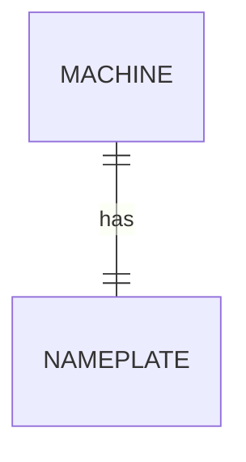

# Module 2 Study Log

**Members:** <Rayan Slassi, Aron Grudaj, Jonathan Behring> | **Date:** <15.10.2026>

---

## Task A: Pod study

### 1. References I used

| <ER model> | <https://en.wikipedia.org/wiki/Entity%E2%80%93relationship_model> | <Learned the basic idea oh how an ER model should look> |
| <EER model> | <https://en.wikipedia.org/wiki/Enhanced_entity%E2%80%93relationship_model> | <Enhanced version of the regular ER Model> |

### 2. Things I googled
what is a surrogate key? and a natural key? 

### 3. Remarkable things
- <surprise / aha / counterexample>

### 4. LLM Q&A
*Prompt:** "Explain the difference between a natural key and a surrogate key, and give one real scenario where choosing the wrong one causes a data bug."
**Answer (summary):** A natural key is real-world data (email, serial number). A surrogate key is a synthetic ID. Using a natural key as PK is risky if the value can change (e.g. a person's email address). The wrong choice causes update anomalies when the natural key changes.
**How I verified it:** Ran `SELECT part_no, COUNT(*) FROM part GROUP BY part_no HAVING COUNT(*) > 1;` on `legacy.db`. Confirmed `P-1003` is duplicated because `part_no` has no UNIQUE. This proves the LLM's claim: "without a UNIQUE constraint, a natural key is not actually a key."

### 5. My best ER sketches
**Sketch 1**
- Source: <link or credit>
- Image: 
- What I learned that the others didn't show: <sentence>
---

## Task B: From words to sketch

### 1. 1:1 (machine and nameplate)
- Entities: <...>
- Attributes: <...>
- Relationship and cardinality: <...>
- Where the key goes / entity or attribute?: <answer>



### 2. 1:n (machine and sensors)
(same structure)

### 3. m:n (work orders and parts)
(same structure)

### 4. Entity vs. attribute vs. relationship (job, machine, technician)
(same structure)

### Proof: CREATE TABLE and COUNT
```sql
-- CREATE TABLE for my favourite sketch
-- two INSERT statements
-- the COUNT query that shows the cardinality
```
**Result:** <paste output and one sentence of interpretation>

---

## Task C: Agreed learning (pod discussion)
## Working with another Task Pod

- ERD: Multiple Attributes stored in datacells. When they are connected together, they create a database.
- Cardinality: the relationship between different attributes (1:1, 1:m, etc)
- EER: ERD, with sub-Topics (sub-attributes). It introduces Inheritance.
- Natural key: a related real-world tangible ID 
- surrogated key is snd invented key that is generated in the database and is unrelated to the real world.
- Foreign key: a key to access foreign databases. It creates a link between 2 databases.
- 1NF: Every value Needs its own place. One cell cannot hold multiple values.  
- The code side: needed to access data from databases. we can SELECT, INSERT INTO, DELETE, etc.
- 

- **Image posted in Discord:** <description or file> (why: <one sentence>)

- Aha: Defect 3 — `unit_price < '15'` on TEXT excluded P-1003 (€9.90) because `'9.90' > '15'` as string. The cheapest part vanishes from the report. No error. This is exactly the kind of silent corruption the module warns about.
